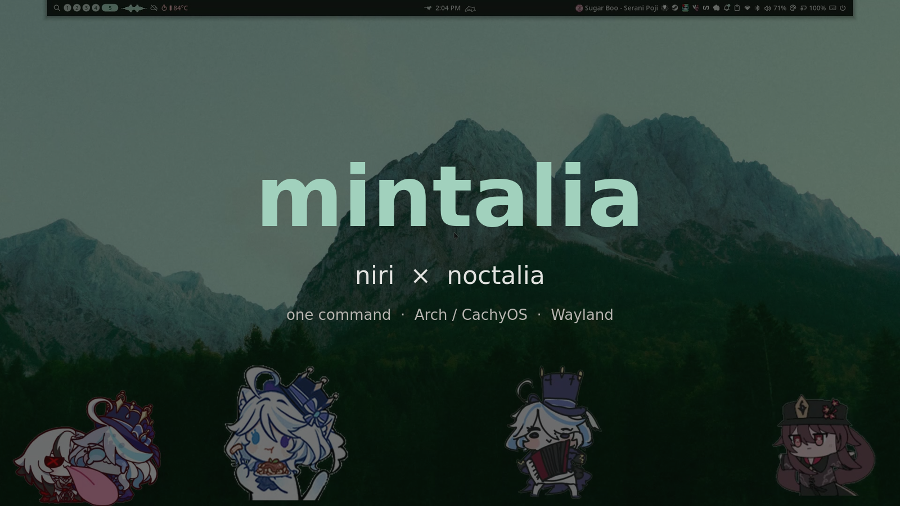
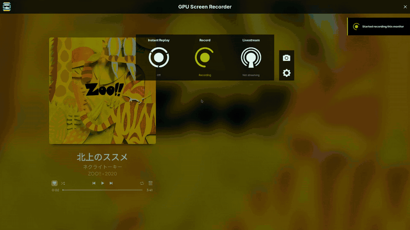
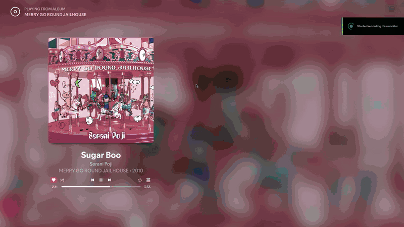
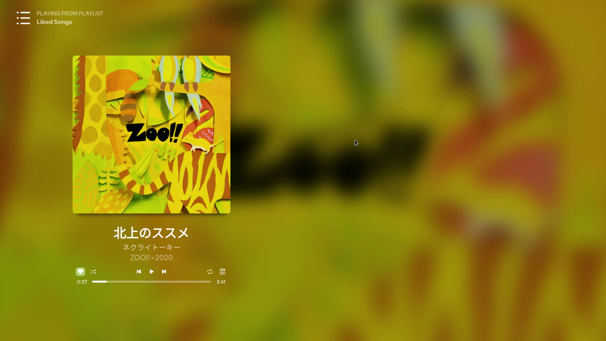
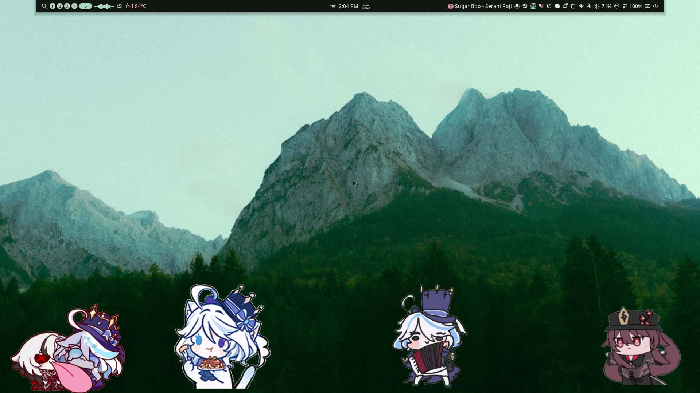
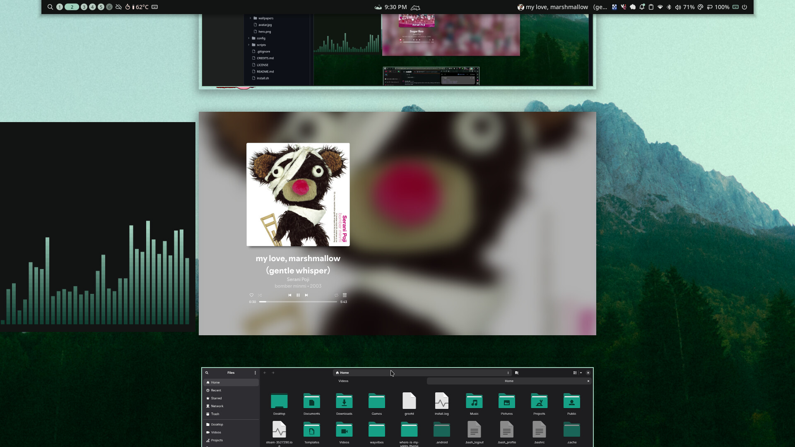
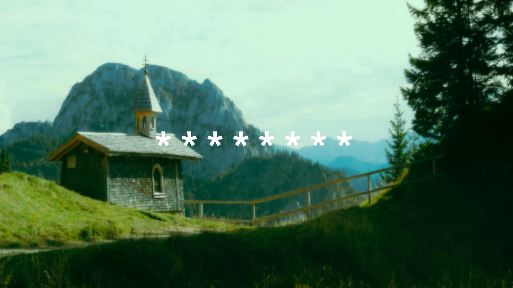

<div align="center">



# mintalia

**niri × noctalia** — a soft-mint, wallpaper-reactive Wayland desktop.

[](https://archlinux.org)
[](https://wayland.freedesktop.org)
[](https://github.com/YaLTeR/niri)
[](https://noctalia.dev)
[](LICENSE)

<a href="assets/demo/demo-1.mp4"></a>
<a href="assets/demo/demo-2.mp4"></a>

<sub>Click a preview for the full-quality MP4 · 31 s desktop tour · 10 s sticker showcase</sub>

</div>

---

## One command

```bash
bash -c "$(curl -fsSL https://raw.githubusercontent.com/IgnazBhatta/mintalia/main/install.sh)"
```

Run it as your normal user in a terminal (not as root). It asks a few questions, installs
**Noctalia first**, backs up anything it replaces, then copies the theme into place.

After it finishes, **log out and back in** (or reboot) and pick **niri** in SDDM.

> The installer targets **Arch-based** systems (Arch, CachyOS, EndeavourOS) and uses
> `pacman` + an AUR helper. It asks before installing optional apps.

### What it asks

| Prompt | What happens if you say yes |
|---|---|
| **Discord** | Installs `vesktop-bin` and copies the Noctalia Midnight + Material themes, plus Vencord/Jord settings |
| **Spotify** | Installs `spotify` + `spicetify-cli`, the Marketplace app, and enables Noctalia's Spicetify color sync |
| **Wayvibes** | Installs `wayvibes-git`, the **NK Cream** soundpack, and the bar widget state |
| **Browser** | **Floorp** — your `userChrome`/`userContent` + the animated *Spirited Away* theme · **Zen** — recolors itself from Noctalia's palette · or skip |

Everything else (niri, noctalia, kitty, fish, fastfetch, nautilus, vlc, nirimod, shelly)
is installed automatically.

### Non-interactive

```bash
./install.sh --yes                                  # defaults: no optional apps
./install.sh --discord --spotify --wayvibes --browser=zen
./install.sh --browser=floorp --no-sddm
```

| Flag | Meaning |
|---|---|
| `-y`, `--yes` | Accept defaults (skip optional apps) |
| `--discord` / `--no-discord` | Toggle Vesktop + Discord themes |
| `--spotify` / `--no-spotify` | Toggle Spotify + Spicetify |
| `--wayvibes` / `--no-wayvibes` | Toggle Wayvibes + soundpack |
| `--browser=floorp\|zen\|none` | Pick the browser theme |
| `--no-sddm` | Leave the login manager untouched |
| `--help` | Show all options |

---

## What's inside

<div align="center">


</div>

<div align="center">

</div>

<div align="center">

<br />
<sub>SDDM login screen · <code>wallhaven-zpvrov</code> wallpaper with a 12 px blur</sub>
</div>

### The shell

- **niri** with spring animations, custom column presets, and a clean keybind set.
- **Noctalia v5** bar with a custom widget order:
  `launcher · workspaces · warp · temp · keybinds` on the left,
  `cat · clock · cat` in the center,
  and `media · tray · notifications · clipboard · network · bluetooth · volume · widget · battery · wayvibes · session` on the right.
- **8 plugins**: audio-sticker, warp, bongocat, keybind-cheatsheet, wallhaven, cat,
  wayvibes, color picker.
- **4 audio-reactive Genshin stickers** on the desktop. Their positions are rescaled
  automatically to your monitor resolution.
- Colors are generated from the wallpaper (`m3-content`), so the whole desktop
  (bar, GTK, kitty, btop, cava, Spotify, Discord, Zed) follows the current wallpaper.
- **22 wallpapers** in 4K, including the default one used above.

### The terminal

- **kitty** with the Noctalia palette, SF Mono → JetBrainsMono Nerd Font fallback,
  a fish prompt chevron from MesloLGS, beam cursor with trail, and Ctrl+C copy bindings.
- **fish** with the CachyOS prompt (sourced only when present) and a `greet` function.
- **fastfetch** with a Hu Tao pixel-art logo and a warm sunset gradient — all modules are
  dynamic, so it shows **your** distro, host, CPU, memory, and disk, never mine.

### Apps & system

- **Nautilus** with `adw-gtk3-dark`, Papirus-Dark icons, and capitaine cursors.
- **SDDM** theme installed as `/usr/share/sddm/themes/mintalia` with the
  `wallhaven-zpvrov` wallpaper, a 12 px blur, and its own
  `/etc/sddm.conf.d/99-mintalia.conf` (skip with `--no-sddm`).
- **btop** + **cava** Noctalia themes, KDE color scheme, Zed theme.
- Optional **Vesktop**, **Spotify/Spicetify**, **Wayvibes**, **Floorp/Zen**.

---

## Keybinds

`Mod` is **Super**.

| Key | Action | Key | Action |
|---|---|---|---|
| `Mod+Return` | kitty | `Mod+Space` | app launcher |
| `Mod+B` | browser (chosen at install) | `Mod+E` | Nautilus |
| `Mod+Shift+W` | wallpaper picker | `Mod+Shift+S` | control center |
| `Mod+Shift+Q` | session menu | `Mod+Alt+L` | lock screen |
| `Mod+Shift+V` | clipboard | `Mod+Slash` | keybind cheatsheet |
| `Mod+Z` | Noctalia settings | `Mod+Shift+Escape` | hotkey overlay |
| `Mod+Tab` | overview | `Mod+Q` | close window |
| `Mod+T` | toggle floating | `Mod+F` | maximize column |
| `Mod+Shift+F` | fullscreen | `Mod+R` / `Mod+Shift+R` | column width preset |
| `Mod+1…9` | workspace 1–9 | `Mod+Ctrl+1…9` | move column to workspace |
| `Mod+Left/Right/Up/Down` | focus | `Mod+Ctrl+Arrows` | move window |
| `Print` | region screenshot | `Mod+Print` / `Mod+Shift+Print` | screen / window |
| `Mod+M` | Spotify (if installed) | `Mod+C` / `Mod+V` | editor (if installed) |

Media keys (volume, mic, brightness, playback) are wired through `noctalia msg`.

---

## Customization

**Wallpaper** — `Super+Shift+W`, or:

```bash
noctalia msg wallpaper-set ~/Pictures/Wallpapers/<file>
noctalia msg color-scheme-set wallpaper m3-content
```

The default installed wallpaper is `wallhaven-k8j6k6_3840x1600.png`.
The SDDM login screen uses `wallhaven-zpvrov_3840x1600.png` with a 12 px blur.
Nothing in `~/Pictures/Wallpapers` is overwritten if it already exists.

**Stickers** — replace the GIFs in `~/Pictures/Stickers` and edit them in
*Noctalia → Settings → Desktop widgets*. The shipped positions were authored on
1920×1080 and are rescaled by `scripts/render.py` to the output detected at install time.

**Monitor name** — templates use `__OUTPUT__`; the installer reads your primary output
from `niri msg --json outputs`. Wrong output? Set it manually in
`~/.config/noctalia/config.toml` and reload.

**Backups** — every file the installer touches is saved first to
`~/.mintalia-backup/<timestamp>/`, with an `install.log` next to it.

---

## Repository layout

```
mintalia/
├── install.sh                  # one-command installer
├── assets/
│   ├── demo/                   # 2 MP4s + GIF previews
│   ├── screenshots/            # README gallery
│   ├── wallpapers/             # 22 originals
│   ├── stickers/               # 4 Genshin sticker GIFs
│   ├── sounds/nkcream/         # Wayvibes soundpack
│   └── avatar.jpg
├── config/
│   ├── niri/                   # config.kdl + cfg/*.kdl
│   ├── noctalia/               # config.toml
│   ├── kitty/  fastfetch/  fish/
│   ├── gtk-3.0/  color-schemes/  kdeglobals
│   ├── btop/  cava/  zed/
│   ├── floorp/  vesktop/  spicetify/
│   └── sddm/
└── scripts/
    ├── render.py               # placeholders + monitor rescaling
    └── set-wallpaper.py        # merge wallpaper into Noctalia state
```

Configs are stored with `__HOME__` and `__OUTPUT__` placeholders and rendered at
install time, so no personal paths or usernames are committed.

---

## Privacy

- No SSH/GPG keys, browser profiles, Spotify prefs, Discord sessions, keyrings,
  shell history, notification history, clipboard data, or game saves.
- Fastfetch uses only dynamic modules — your specs, not mine.
- Every `/home/<user>` path is templated.
- Wallpapers and stickers are checked in; nothing from `Documents`, `Downloads`,
  or `Videos` outside the two demo clips.

---

## Credits

This repo is a curated theme, not original software. Huge thanks to:

- **[niri](https://github.com/YaLTeR/niri)** — YaLTeR and contributors
- **[Noctalia](https://github.com/noctalia-dev/noctalia)** & **[Quickshell](https://quickshell.org)** — the shell and its ecosystem
- **Plugins**: [miixz/audio-sticker](https://github.com/noctalia-dev/community-plugins), [levi/warp](https://github.com/noctalia-dev/community-plugins), [noctalia/bongocat](https://github.com/noctalia-dev/official-plugins), [kenn/keybind-cheatsheet](https://github.com/noctalia-dev/community-plugins), [noctalia/wallhaven](https://github.com/noctalia-dev/official-plugins), [dotnetrob/cat](https://github.com/noctalia-dev/community-plugins), [viksit-garg/wayvibes](https://github.com/noctalia-dev/community-plugins), [oldirtty/color_picker](https://github.com/noctalia-dev/community-plugins)
- **[niri-pip](https://github.com/t1ktakdev/niri-pip)** — not bundled; its keybind is intentionally removed
- **[Spicetify](https://spicetify.app)** & **Marketplace**
- **[Midnight Discord](https://github.com/refact0r/midnight-discord)** by refact0r — base for the Vesktop themes
- **Spirited Away (Animated)** theme by **Max** on [addons.mozilla.org](https://addons.mozilla.org/firefox/addon/spirited-away-animated/)
- **[Where is my SDDM theme?](https://github.com/stepanzubkov/where-is-my-sddm-theme)** by stepanzubkov (MIT)
- **[Wayvibes](https://github.com/sahaj-b/wayvibes)** by sahaj-b
- **Wallpapers** — [wallhaven.cc](https://wallhaven.cc) and the original artists; each file keeps its source name
- **Hu Tao artwork & Genshin stickers** — © HoYoverse / miHoYo. Fan use only, not affiliated.
- **Fonts** — JetBrains Mono, MesloLGS, SF Mono (not redistributed)

If you own an asset here and want it removed, open an issue and it will be taken down.

## License

Configs and scripts in this repository are released under the [MIT License](LICENSE).
Third-party themes, artwork, and plugins keep their own licenses and belong to their authors.
